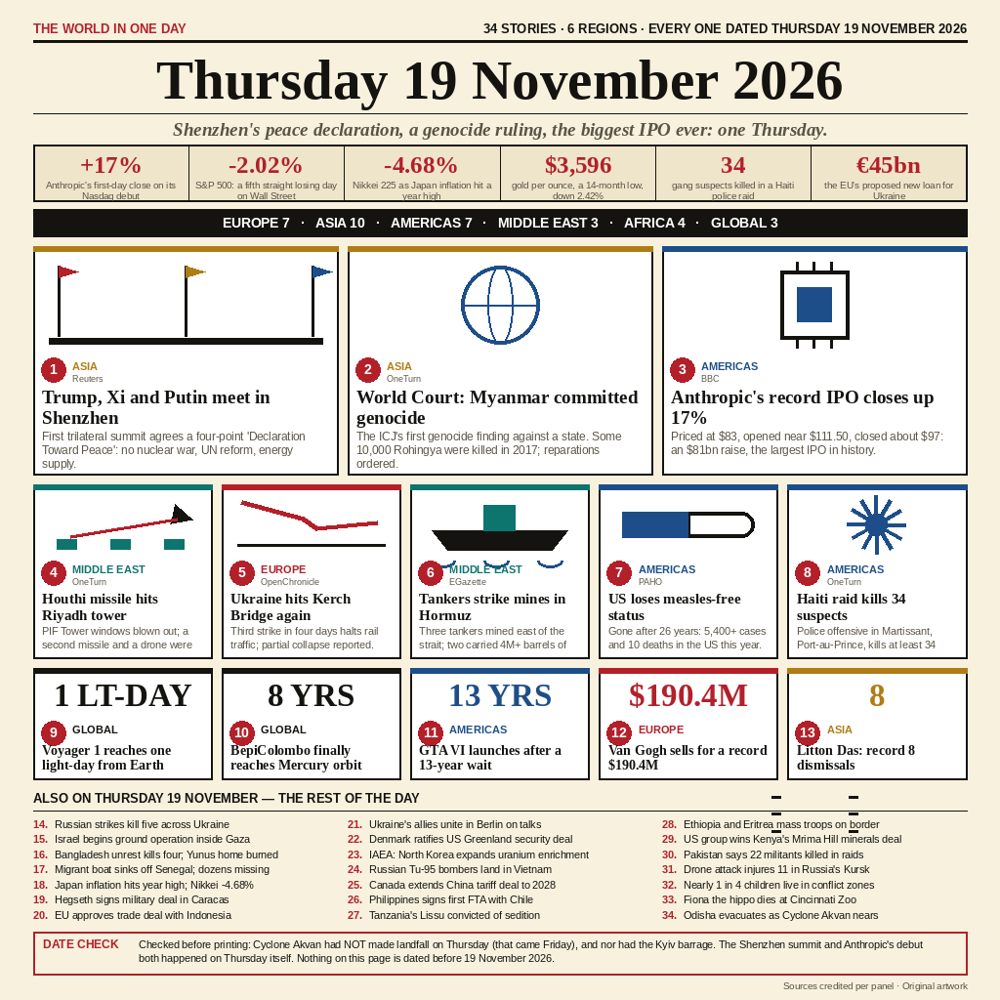

# Thursday 19 November 2026 — The World in One Day

Built for the make.fun bounty [“Sum up 19 November's world news in one image”](https://make.fun/bounty/news-image-20261119).

A single-image broadsheet summarising the world news of **Thursday
19 November 2026**: 34 stories across 6 regions, drawn as an original
front page.

## Headlines

1. **Shenzhen** — Trump, Xi and Putin hold their first trilateral summit and
   agree a four-point "Declaration Toward Peace" (Reuters).
2. **The Hague** — the World Court finds Myanmar committed genocide against
   the Rohingya; reparations ordered (OneTurn).
3. **Nasdaq** — Anthropic's debut closes up 17%, an $81bn raise, the largest
   IPO in history (BBC).
4. A Houthi missile damages Riyadh's PIF Tower; 5. Ukraine strikes the Kerch
   Bridge a third time; 6. three tankers strike mines in the Strait of
   Hormuz; 7. the US loses measles elimination status after 26 years;
   8. a Haiti police raid kills 34 gang suspects.
9. Voyager 1 reaches one light-day from Earth; 10. BepiColombo reaches
    Mercury orbit after 8 years; 11. GTA VI launches after a 13-year wait;
    12. a Van Gogh sells for a record $190.4M; 13. Litton Das takes a record
    8 dismissals in a Test innings.
14.–34. briefs: Russian strikes on Ukraine, Israel's Gaza ground operation,
    Bangladesh unrest, the Senegal migrant boat, Japan inflation, the
    Caracas military deal, EU trade deals, the Greenland ratification,
    North Korea enrichment, Tu-95s in Vietnam, Canada–China tariffs, the
    Philippines–Chile FTA, Tanzania, Ethiopia–Eritrea, Kenya's Mrima Hill,
    Pakistan raids, Kursk drones, children in conflict zones, Fiona the
    hippo, and Odisha's evacuations ahead of Cyclone Akvan.

Every item is dated Thursday 19 November 2026 and cross-checked against at
least two of the day's digests (OneTurn, OpenChronicle, EGazette, Reuters
headlines). The DATE CHECK box on the page records what was deliberately
excluded as not-Thursday news (Akvan's landfall and the Kyiv barrage both
came on Friday).

## How it is built

- `draw.py` — the data-driven generator (PIL, build-time only). All stories
  live in its tables; generic engines render the masthead, by-the-numbers
  strip, region bar, 13 panels, briefs and the date-check strip.
- `entry.png` — the rendered page, 1024×1024, byte-identical across runs.
- `main.py` — the submitted program (Python 3.13, standard library only):
  copies `entry.png` to the output path (`$MAKEFUN_OUTPUT_DIR` or
  `/output/entry.png`). No network, fully deterministic.

## License

MIT — see `LICENSE`.
